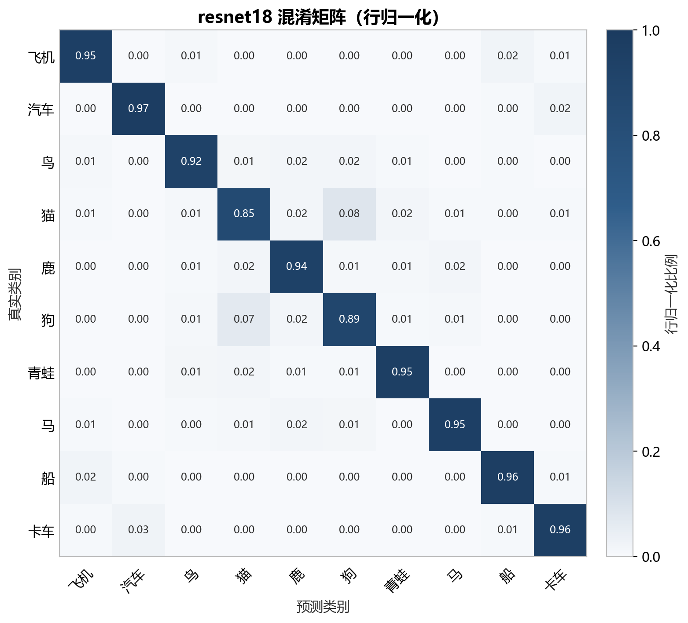
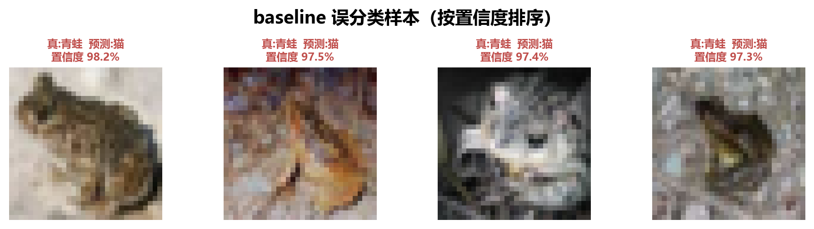
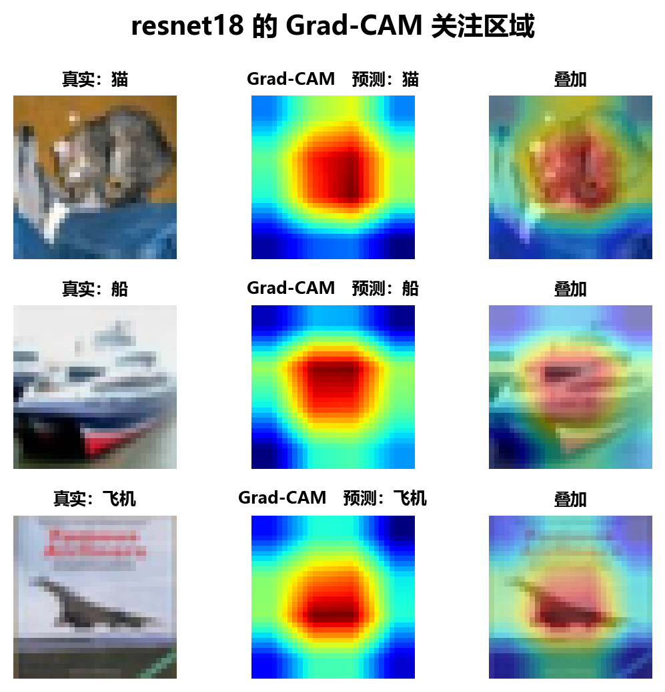

# 实验三：CIFAR-10 图像分类模型的设计与实现

**代码仓库**：<https://github.com/begonialavender/homework1/tree/作业3>（代码与 README 在 `3/` 目录下）

## 1 任务与数据

在 CIFAR-10 上完成图像分类任务的全流程：模型设计、训练、评估与可视化分析。数据集共 60000 张 32×32 彩色图像，10 个类别，官方划分为 50000 训练 / 10000 测试。

实验**没有**让测试集参与任何训练决策：从官方训练集按 9∶1 切出 45000 张训练与 5000 张验证，验证集用于选模型与早停，官方测试集只在最后评估一次。划分使用固定种子 42，训练与验证共用同一批图像索引但使用不同变换流水线——验证集不做随机增强，避免评估抖动。

预处理为 `ToTensor()` 加通道归一化（均值 `(0.4914,0.4822,0.4465)`、标准差 `(0.2023,0.1994,0.2010)`）。训练集提供三档增强做消融：**none**（不增强）、**base**（`RandomCrop(32,padding=4)` + 水平翻转）、**strong**（base + `RandAugment(2,9)` + `RandomErasing(0.25)`）。

## 2 模型设计

| 模型 | 结构要点 | 参数量 | 初始权重 |
| --- | --- | --- | --- |
| BaselineCNN | 3 个卷积阶段（64/128/256 通道），GAP + Dropout | 1.15M | 随机 |
| SECNN | 结构同上，每个阶段后加 SE 通道注意力 | 1.17M | 随机 |
| ResNet18 | 残差块，主干按 CIFAR 改造 | 11.17M | ImageNet 预训练 |
| MobileNetV2 | 深度可分离卷积 + 倒残差 | 2.24M | ImageNet 预训练 |

**BaselineCNN** 采用 VGG 风格直筒结构：每个阶段是两层 3×3 卷积 + BN + ReLU，接 2×2 最大池化，通道数 64→128→256，最后用全局平均池化代替大尺寸全连接层再接 `Dropout(0.3)` 与 10 类输出。两个 3×3 堆叠的感受野相当于一个 5×5 但参数更少、非线性更强；GAP 则把分类头参数从数百万压到几乎为零。

**SECNN** 与 BaselineCNN 严格对齐，唯一区别是每个卷积阶段后插入 SE 模块：先全局平均池化把 C×H×W 压成 C 维向量（squeeze），经两层全连接（通道数降至 C/8 再升回）与 Sigmoid 得到通道权重（excitation），最后逐通道乘回特征图（scale）。它让网络按图像内容动态决定哪些通道更重要，额外参数极少。

**ResNet18** 用残差连接 `y = F(x) + x` 让梯度沿恒等映射回传，缓解深层网络的梯度消失。**针对 32×32 输入的改造是迁移学习能否奏效的前提**：原主干用 7×7/stride2 卷积接 3×3/stride2 最大池化，在 224×224 上降采样 4 倍；直接搬到 CIFAR 上，第一次卷积后只剩 16×16、池化后 8×8，空间信息损失过大。改为 `conv1 = 3×3/stride1`、去掉 maxpool 后，总下采样倍数为 8，最终特征图 4×4。不改造成时预训练 ResNet18 在 CIFAR 上往往只能到 80% 左右。

**MobileNetV2** 用于回答"参数量小一个数量级会损失多少精度"，同样把首层卷积的 stride 改为 1 以保留分辨率。

## 3 训练策略

| 项目 | 配置 |
| --- | --- |
| 损失 | 交叉熵 + 标签平滑 0.1 |
| 优化器 | 自建网络 AdamW，lr 1e-3；预训练模型 SGD(momentum 0.9, nesterov)，lr 0.01 |
| 权重衰减 | 5e-4 |
| 学习率调度 | 余弦退火（`CosineAnnealingLR`） |
| 早停 | 验证准确率连续 10 轮不提升则停止，回滚最佳权重 |
| 其他 | 梯度裁剪 max_norm=1.0、AMP 混合精度、batch 128 |
| 轮数 | 自建 CNN 30 轮，预训练模型 20 轮 |

标签平滑把 one-hot 标签软化为 `[0.01,…,0.91,…]`，不鼓励模型把正确类 logit 推向无穷大，对"看着像猫也像狗"的模糊样本更宽容，能降低过拟合。余弦退火让学习率前期快速下降、后期平滑衰减到接近 0，不需要手工设衰减节点。预训练模型用 SGD 而非 AdamW，是为了在 ImageNet 权重附近保持稳定、不破坏已有特征。

## 4 实验结果

全部指标在官方测试集（10000 张）上计算：

| 实验 | 测试准确率 | 参数量 | 训练耗时 |
| --- | --- | --- | --- |
| **ResNet18 预训练微调** | **93.46%** | 11.17M | 33.1 min |
| MobileNetV2 预训练微调 | 90.74% | 2.24M | 17.5 min |
| BaselineCNN | 90.46% | 1.15M | 15.1 min |
| SECNN | 90.04% | 1.17M | 18.7 min |
| Baseline（强增强） | 89.92% | 1.15M | 20.0 min |
| Baseline（无增强） | 87.89% | 1.15M | 16.4 min |
| ResNet18 从零训练 | 79.69% | 11.17M | 31.1 min |

从训练曲线可以看出预训练模型的收敛速度完全是另一个量级：ResNet18 第 1 轮结束验证准确率就有 77.8%、第 3 轮 88.4%；而同样结构从零训练跑满 20 轮才勉强到 80.1%。自建 CNN 则表现出轻微过拟合——第 28 轮训练准确率 97.0%、验证 90.8%，相差 6.2 个百分点，验证损失在第 22 轮后基本停在 0.76 附近不再下降，这正是早停取第 28 轮权重的理由。

## 5 结果分析

### 5.1 分类难度分布

所有模型呈现一致的难易分层：汽车、船、卡车、飞机这类"轮廓硬、背景单一"的类别准确率最高（ResNet18 上 95% 以上），猫、狗、鸟这类"姿态多变、毛发纹理相近"的类别最低。ResNet18 上 cat 85.1%、dog 89.0%，两者互判（cat→dog 82 次、dog→cat 65 次）是所有类别对里最多的，说明模型学到的不是数据划分的偶然性。从零训练的 ResNet18 在"鸟"上崩得最厉害（69.5%），鸟的类内差异极大，正需要更强的特征表达，暴露了小数据 + 短训练预算下深层网络的劣势。

### 5.2 误分类样本分析

把 BaselineCNN 的误分类样本按置信度排序，最有信息量的不是"错得多"而是"错得有多自信"：置信度最高的 12 个错误里有 11 个是**青蛙被判成猫**，置信度全部高于 96%。下图为其中置信度最高的 4 例：

逐张看可归纳为三类原因：

1. **纹理与颜色主导、形状被忽略**——这些青蛙多趴在褐色泥土或枯叶上，整体色调接近猫的毛色，模型抓住"褐色的、毛茸茸的"低层统计特征就下结论，没有去看有没有四条腿和尾巴。
2. **目标过小或被遮挡**——有的图里青蛙只占很小一角，32×32 经过三轮下采样后只剩几个像素，信息本身不足以判别。
3. **标注边界模糊**——个别图里蛙与地面几乎融为一体，人眼也要辨认几秒，已接近数据集标注噪声的下限。

对比而言，ResNet18 的高置信度错误更分散（automobile→airplane、dog→cat、deer→cat 都有），而非集中在某一类，说明更好的特征表示不仅抬高平均精度，也让错误更接近数据本身的难度分布。

### 5.3 消融实验

| 对照项 | 设置 A | 设置 B | 差值 | 结论 |
| --- | --- | --- | --- | --- |
| 数据增强 | 无 87.89% | base 90.46% | +2.57 | 增强有效 |
| 增强强度 | base 90.46% | strong 89.92% | −0.54 | 强增强过头 |
| SE 注意力 | 90.46% | 90.04% | −0.42 | 小模型无收益 |
| 预训练 | 从零 79.69% | 预训练 93.46% | +13.77 | 收益最大 |

**数据增强**是性价比最高的正则化，去掉后全线下降（猫掉得最多，75.6% vs 80.2%），因为模型开始死记物体在画面中的固定位置。但**强增强反而略伤**：RandAugment 的旋转、错切会把本就只占十几个像素的物体推出画面或压扁到无法辨认，等于喂给模型"无法分类的样本"。有意思的是增强强度加大后"汽车"反而提升（94.7→96.1），说明颜色扰动对形状稳定、颜色多变的类别是有帮助的。

**SE 没有带来收益**（90.04% vs 90.46%，在 ±0.3% 的重复训练抖动内），这一点值得解释而不是简单归为"没用"：BaselineCNN 只有 3 个阶段、特征通道最多 256，可挑选的通道余地本来就小；30 轮训练下 SE 的两个全连接层还没学出有意义的通道权重；SE 增加的是参数效率而非表达能力，在容量本就紧张的小模型上收益易被噪声掩盖。要验证应把网络加深加宽、训练 100 轮以上——这是受算力限制没做的部分。

**预训练是最大的杠杆**：同结构下 93.46% vs 79.69%，差 13.77 个百分点。预训练模型在 ImageNet 上已学会"边缘—纹理—部件—物体"的通用特征，微调只需重新做"特征→类别"的映射；从零训练要同时学特征提取和分类两件事，在 45000 张 32×32 图像、20 轮的条件下根本来不及。

### 5.4 精度与成本

自建 1.15M 的 CNN 已能到 90.46%，参数只有 ResNet18 的十分之一；MobileNetV2 参数量约为 ResNet18 的五分之一，精度低 2.7 个点，处在尴尬位置——深度可分离卷积的优势更适合大分辨率、多类别任务，在 32×32 小图上表达能力受限更明显。若要求极致精度且算力允许，ResNet18 的 3 个百分点提升是实打实的。

## 6 可解释性分析

Grad-CAM 取最后一个卷积层特征图 `A^k`，对目标类别分数求梯度并在空间维上全局平均得到通道权重 `α_k = (1/Z)Σ_{ij} ∂y^c/∂A_ij^k`，再对特征图加权求和并过 ReLU（只保留对目标类有正向贡献的区域），最后上采样到原图尺寸。实现未引入额外依赖，用 forward hook 保存激活、`retain_grad()` 取梯度完成。

热力图显示：热区确实落在物体主体上——猫的热区覆盖身体和头部，船落在船体，飞机落在机身而不是天空；热区比物体略大、边缘外溢，是 4×4 特征图双线性上采样的必然结果（一格对应原图 8×8 像素）。两个模型的关注方式也不同：自建 CNN 的热区更集中、更像一个点，说明更依赖局部最具判别力的小区域；ResNet18 覆盖更完整，接近"整体部件"级判断，与两者精度差异一致。这说明模型是在"看物体"，没有利用背景相关性走捷径。

> 目标层选择上做过对比：换成更浅的 8×8 层后热图分辨率提高，但高亮常落在天空、地面等背景纹理上，反而失真，最终仍取 4×4 深层——语义强度优先于空间分辨率，这也是 Grad-CAM 原文的建议。

## 7 结论与不足

**结论**：(1) 轻量 VGG 风格 CNN 配合 BN、Dropout、标签平滑与基础增强即可达到 90.46%，说明结构设计与训练策略有效；(2) 数据增强带来 2.57 个点提升，但强度必须匹配图像尺度，小图上强增强反而有害；(3) 迁移学习是最大杠杆，同结构下提升 13.77 个点且收敛快一个数量级；(4) SE 在小模型、短训练预算下无收益，需更深网络与更长训练验证；(5) 误差集中在语义相邻类别，高置信度错误多由纹理相似、目标过小导致；(6) Grad-CAM 证实模型关注物体主体而非背景。

**不足**：(1) 受限于 RTX 3050 4GB，预训练模型只微调 20 轮，延长到 50 轮并加 warmup 预计还能提升 0.5 个点；(2) 未做模型集成，ResNet18 与 MobileNetV2 预测平均通常可再涨 0.5%~1%；(3) 可解释性只做定性分析，可进一步用 pointing game 指标量化 Grad-CAM 与真实边界的重合度；(4) 自建网络没有残差连接，加深容易退化。

## 附录：代码结构

| 文件 | 作用 |
| --- | --- |
| `main.py` | 命令行入口：train / eval / gradcam / compare |
| `run_experiments.py` | 一键复现全部 7 组实验（支持断点续跑） |
| `src/data.py` | 数据划分、归一化、三档数据增强 |
| `src/models.py` | BaselineCNN / SECNN / ResNet18 / MobileNetV2 |
| `src/train.py` | 训练循环、AMP、余弦退火、早停、checkpoint |
| `src/evaluate.py` | 总体与每类准确率、混淆矩阵、误分类样本 |
| `src/visualize.py` | 训练曲线、混淆矩阵热图、误分类拼图、增强示例 |
| `src/gradcam.py` | Grad-CAM 实现与可视化 |
