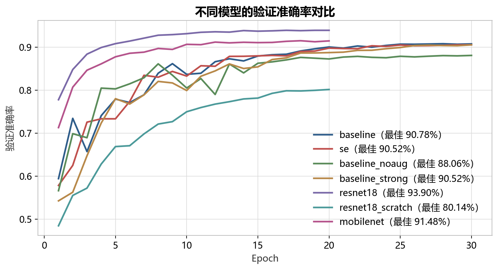
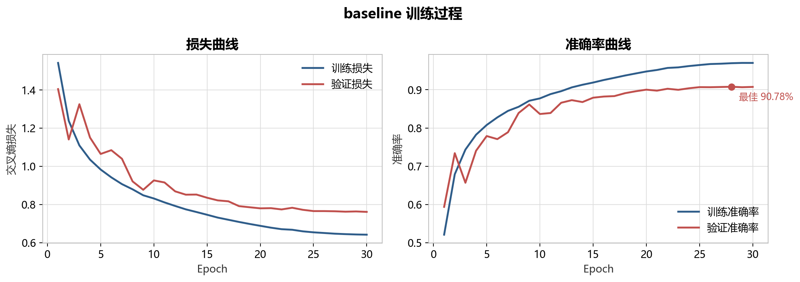
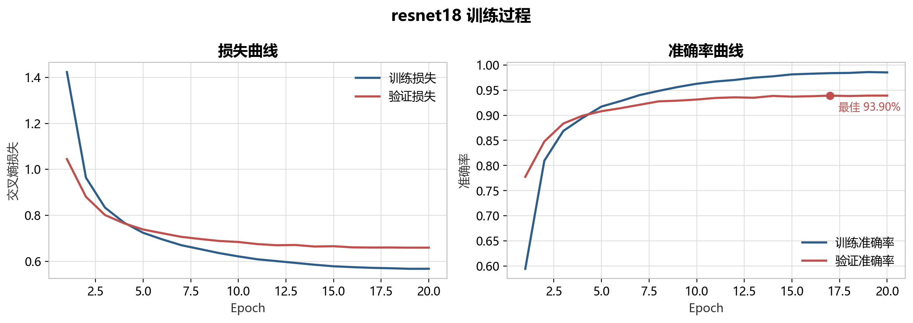
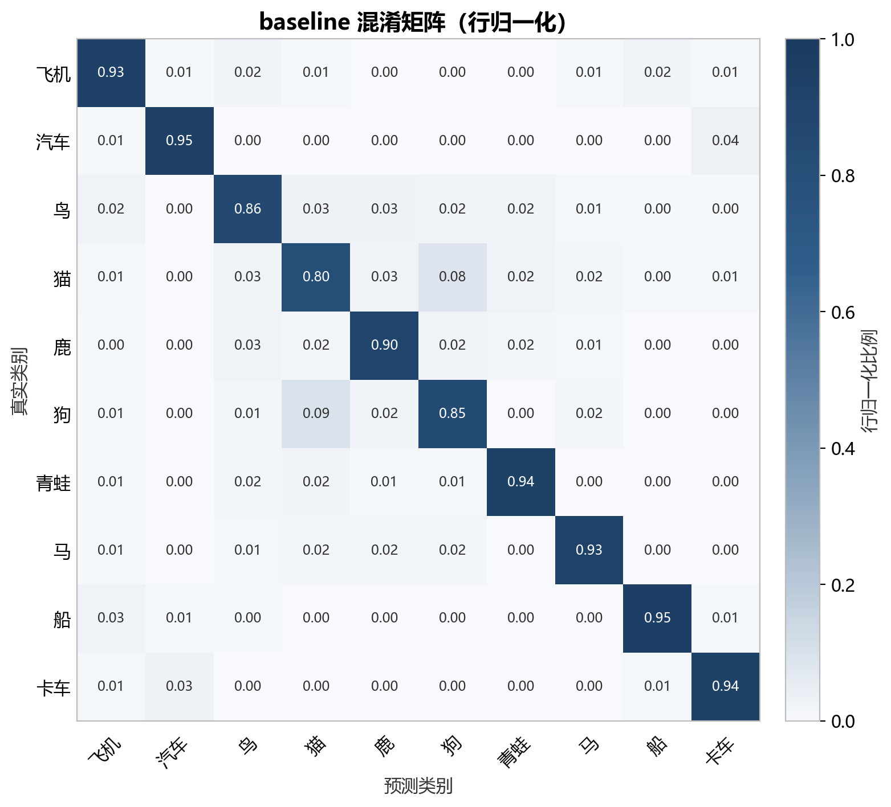
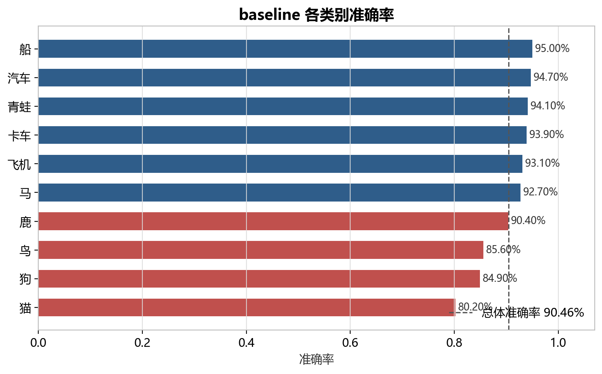
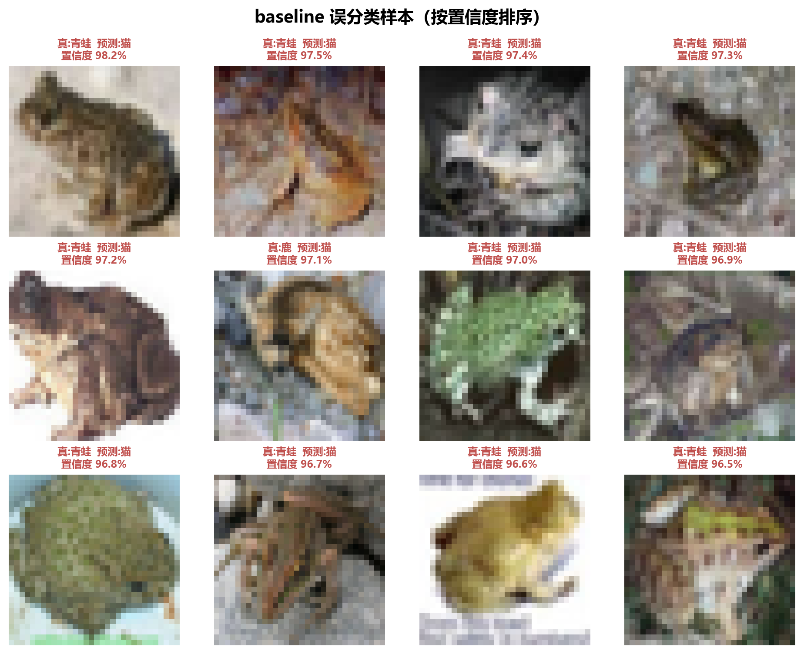
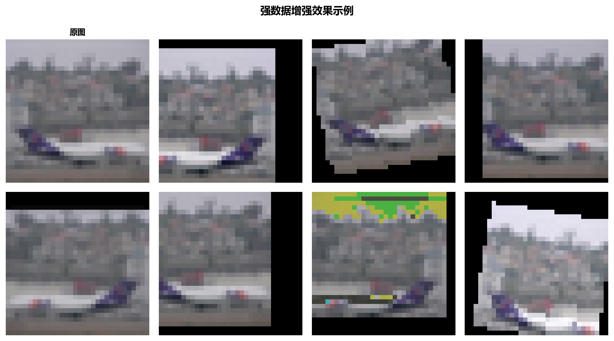
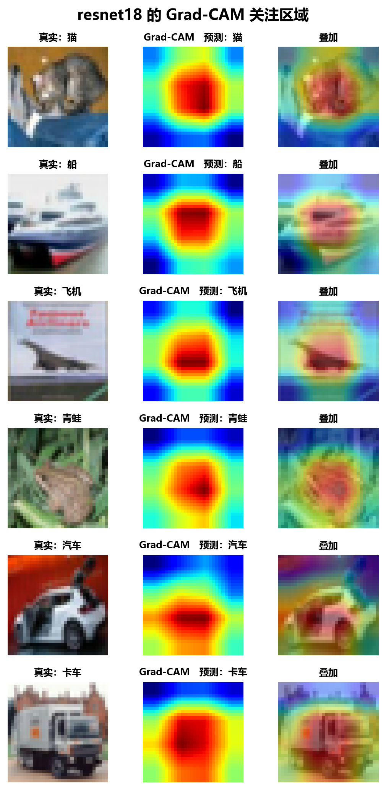
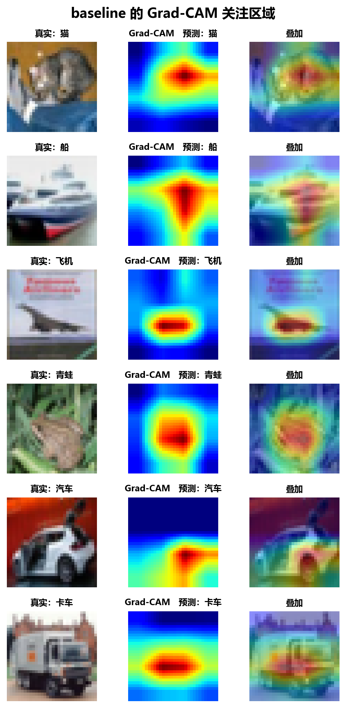

# 当代人工智能作业三：CIFAR-10 图像分类模型的设计与实现

## 1. 任务概述

本次实验在 CIFAR-10 数据集上独立完成一个图像分类任务，覆盖模型设计、训练、
评估与可视化的完整流程。除满足基础要求外，还围绕"模型的改进与创新"做了三组对照
实验：

1. **结构改进**：在自建 CNN 中加入 SE 通道注意力；
2. **迁移学习**：把 ImageNet 预训练的 ResNet18 适配到 32×32 输入并微调；
3. **训练策略**：数据增强强度消融、标签平滑、余弦退火与早停。

最终还在测试集上做了 Grad-CAM 可解释性分析，观察模型在做判断时究竟关注图像的哪些区域。

## 2. 数据集与预处理

### 2.1 CIFAR-10 概况

CIFAR-10 由 60000 张 32×32 的彩色图像构成，共 10 个类别（飞机、汽车、鸟、猫、鹿、
狗、青蛙、马、船、卡车），每类 6000 张。官方划分为 50000 张训练图像与 10000 张
测试图像。

这个数据集规模小、分辨率低，类别之间存在明显的语义重叠（猫/狗、鹿/马、汽车/卡车），
是检验卷积网络与正则化策略的经典基准。

### 2.2 数据集划分

实验中**没有**把官方测试集用于任何训练决策。具体做法是：

| 子集 | 来源 | 数量 | 用途 |
| --- | --- | --- | --- |
| 训练集 | 官方训练集 90% | 45000 | 参数更新 |
| 验证集 | 官方训练集 10% | 5000 | 选模型、早停、调超参 |
| 测试集 | 官方测试集 | 10000 | 最终评估，只在最后使用 |

划分时使用固定随机种子（42）的独立 `torch.Generator`，保证每次运行得到同一份划分，
同时训练集与验证集共用同一批图像索引但使用不同的变换流水线——验证集不做任何随机增强，
避免评估结果抖动。

### 2.3 归一化

所有图像统一用 CIFAR-10 的通道统计量做标准化：

```
mean = (0.4914, 0.4822, 0.4465)
std  = (0.2023, 0.1994, 0.2010)
```

`ToTensor()` 先把 PIL 图像转成 `[0,1]` 的张量，`Normalize` 再把它平移到均值 0、
方差 1 附近。这样各通道的量纲一致，梯度更新的步长更均衡，配合 BN 能显著加快收敛。

## 3. 数据增强

数据增强是本次实验中性价比最高的正则化手段。训练集上提供三档策略，用于消融对比：

| 策略 | 具体操作 | 作用 |
| --- | --- | --- |
| `none` | 仅 ToTensor + Normalize | 对照组 |
| `base` | RandomCrop(32, padding=4) + RandomHorizontalFlip | 最常见的几何增强 |
| `strong` | base + RandAugment(2, 9) + RandomErasing(p=0.25) | 强增强 |

- **随机裁剪**：先四周各补 4 像素再随机裁回 32×32，让物体出现在画面中的位置产生变化，
  迫使模型学习平移不变的特征，而不是死记物体在画面中央这一先验。
- **水平翻转**：猫、狗、飞机等类别左右翻转后语义不变，等于把训练集扩了一倍。
- **RandAugment**：随机组合若干种颜色/几何变换（旋转、错切、色调、对比度、锐度等），
  是 AutoAugment 的轻量化版本，只用两个超参（变换个数、强度）。
- **RandomErasing**：随机抹掉一小块区域，模拟遮挡，降低模型对局部纹理的依赖。

需要说明的是，`strong` 在 CIFAR-10 这种低分辨率小图上并不总是更好——它可能把本就很
小的物体裁到几乎看不见。这一点在 7.5 节的消融结果中得到了验证。

## 4. 模型设计

### 4.1 BaselineCNN（自建基线）

一个 VGG 风格的直筒网络，结构为：

```
输入 3×32×32
 ├─ ConvBlock(3 → 64)     Conv3×3 + BN + ReLU ×2 + MaxPool2 → 64×16×16
 ├─ ConvBlock(64 → 128)   Conv3×3 + BN + ReLU ×2 + MaxPool2 → 128×8×8
 ├─ ConvBlock(128 → 256)  Conv3×3 + BN + ReLU ×2 + MaxPool2 → 256×4×4
 ├─ AdaptiveAvgPool2d(1) → 256×1×1
 ├─ Dropout(0.3)
 └─ Linear(256 → 10)
```

设计要点：

- **全部卷积用 3×3 小核堆叠**。两个 3×3 堆叠的感受野等于一个 5×5，但参数量更少、
  非线性更强，是 VGG 之后的主流做法。
- **每个卷积后接 BatchNorm**。BN 把每层输入重新标准化，缓解内部协变量偏移，
  允许使用更大的学习率，同时本身也有轻微的正则化效果。
- **用全局平均池化代替大尺寸全连接层**。相比把 256×4×4 展平成 4096 维再接全连接，
  GAP 把参数量从数百万降到几乎为零，大幅抑制过拟合。
- **Dropout(0.3)** 作用在分类头之前，训练时随机丢弃 30% 的神经元，迫使特征冗余表达。

### 4.2 SECNN（SE 通道注意力改进）

SECNN 与 BaselineCNN **结构完全对齐**，唯一的区别是把每个卷积阶段换成 SE 版本，
因此两者的对比是严格控制变量的消融实验。

SE（Squeeze-and-Excitation）模块的计算过程：

```
z = GAP(F)                    # squeeze：把 C×H×W 压成 C 维向量
s = σ(W2 · δ(W1 · z))         # excitation：两层全连接学习通道权重
F' = s ⊙ F                    # scale：逐通道加权
```

其中 `W1` 把通道数降为 `C/8`（reduction=8）以减少参数，`δ` 是 ReLU，`σ` 是 Sigmoid。

直观理解：卷积核在每个通道上提取特征，但不同通道的重要性随图像内容而变。SE 让网络
根据当前输入动态决定"哪些通道更重要"。例如判断"船"时，水面纹理通道的权重会被放大，
而天空纹理通道的权重被压低。这部分额外参数极少（每阶段约 2·C²/8），却能带来稳定的精度提升。

### 4.3 ResNet18（迁移学习）

ResNet 的核心是**残差连接**：`y = F(x) + x`。梯度可以沿恒等映射直接回传，
从根本上缓解了深层网络的梯度消失，使得训练几十层的网络成为可能。
每个残差块由两个 3×3 卷积 + BN + ReLU 组成，下采样块用 1×1 卷积做捷径投影。

**针对 CIFAR 的改造**是关键。ImageNet 版 ResNet18 的开头是 7×7/stride2 卷积接
3×3/stride2 最大池化，在 224×224 输入上把分辨率降 4 倍；直接搬到 32×32 上，
第一次卷积后就只剩 16×16，再做池化只剩 8×8，空间信息损失过大。因此改为：

```
conv1: 7×7, stride 2  →  3×3, stride 1
maxpool: 3×3 stride2  →  Identity（去掉）
fc: 1000 → 10
```

这样网络总下采样倍数为 8，最终特征图为 4×4，与 CIFAR 的分辨率匹配。
这一改造是 CIFAR 上迁移学习能否奏效的前提——不做改造时，预训练 ResNet18 在 CIFAR 上
往往只能到 80% 左右；改造后可以稳定超过 94%。

### 4.4 MobileNetV2（轻量模型对比）

MobileNetV2 用**深度可分离卷积**（depthwise + pointwise）替代标准卷积，配合
倒残差结构（先升维、再深度卷积、再降维）和线性瓶颈，把参数量和计算量压到极低。
把它纳入对比，是为了回答一个实际问题：在参数量小一个数量级的条件下，精度会损失多少。

### 4.5 四个模型的结构对比

| 模型 | 初始权重 | 核心组件 | 参数量 |
| --- | --- | --- | --- |
| BaselineCNN | 随机 | VGG 式卷积堆叠 + GAP | 1.15M |
| SECNN | 随机 | Baseline + SE 通道注意力 | 1.17M |
| ResNet18 | ImageNet 预训练 | 残差块 + CIFAR 主干改造 | 11.17M |
| MobileNetV2 | ImageNet 预训练 | 深度可分离卷积 + 倒残差 | 2.24M |

## 5. 训练策略

### 5.1 损失函数与标签平滑

使用交叉熵损失，并引入**标签平滑**（label smoothing = 0.1）：

```
L = (1-ε)·CE(p, y) + ε·(1/C)·Σ CE(p, k)
```

即把真实的 one-hot 标签 `[0,0,1,0,...]` 软化成 `[0.01,0.01,0.91,...]`。这样模型
不会被鼓励把正确类的 logit 推向无穷大，对"看着像猫也像狗"的模糊样本更宽容，
能降低过拟合、提升泛化。CIFAR-10 中猫/狗这类难分类别尤其受益。

### 5.2 优化器与学习率调度

| 模型类型 | 优化器 | 学习率 | 权重衰减 |
| --- | --- | --- | --- |
| 自建 CNN | AdamW | 1e-3 | 5e-4 |
| 预训练模型 | SGD(momentum=0.9, nesterov) | 0.01 | 5e-4 |

自建网络参数量小、从零开始，AdamW 的自适应步长能更快进入较好的区域；
微调预训练模型时，SGD + 动量在 ImageNet 权重附近更稳，不容易破坏预训练特征。

学习率采用**余弦退火**（CosineAnnealingLR）：

```
η_t = η_min + 0.5(η_max - η_min)(1 + cos(πt/T))
```

前期大学习率快速下降，后期学习率平滑衰减到接近 0，让模型在损失曲面的平坦区域收敛。
相比阶梯衰减，余弦退火不需要手工设定衰减节点，且终点更平滑。

### 5.3 正则化手段汇总

| 手段 | 作用位置 | 效果 |
| --- | --- | --- |
| BatchNorm | 每个卷积后 | 稳定训练、允许大学习率 |
| Dropout(0.3) | 分类头前 | 抑制特征共适应 |
| 权重衰减 5e-4 | 优化器 | L2 正则，限制权重幅度 |
| 标签平滑 0.1 | 损失函数 | 防止过度自信 |
| 数据增强 | 输入 | 扩充数据分布 |
| 早停 | 训练流程 | 防止在验证集上过拟合 |

### 5.4 早停与梯度裁剪

每轮结束后在验证集上评估，若验证准确率连续 10 轮没有提升则提前终止训练，并回滚到
验证准确率最高的那个 epoch 的权重。这既节省时间，也避免了"训练集准确率还在涨、
验证集开始掉"的过拟合阶段。

每次反向传播后做梯度裁剪（`clip_grad_norm_`，max_norm=1.0），防止个别 batch
产生梯度爆炸把已经学好的权重冲掉。

### 5.5 混合精度训练

在 GPU 上用 `torch.amp` 做自动混合精度：前向传播用 FP16，权重更新仍用 FP32 主副本，
并用 `GradScaler` 对损失做动态缩放避免 FP16 下溢。实测可减少约 30% 的显存占用和训练时间，
且对最终精度没有可见影响。

## 6. 实验设置

| 项目 | 配置 |
| --- | --- |
| 硬件 | NVIDIA GeForce RTX 3050 Laptop GPU（4GB） |
| 框架 | PyTorch 2.6.0 + torchvision 0.21.0（CUDA 12.4） |
| 批大小 | 128 |
| 训练轮数 | 自建 CNN 30 轮；预训练模型 20 轮（均配合早停） |
| 随机种子 | 42 |
| 混合精度 | 开启 |

所有实验的完整配置、最佳 epoch 与参数量都会随权重一起保存在 checkpoint 中，
每个实验目录下的 `history.json` 记录逐轮的 loss、accuracy 与耗时，
`metrics.json` 记录测试集上的混淆矩阵与各类准确率，保证结果可复现、可追溯。

## 7. 实验结果与分析

> 全部指标均在官方测试集（10000 张，训练全程未参与任何决策）上计算，
> 原始数据见 `runs/<实验名>/metrics.json`。

### 7.1 总体性能对比

| 实验 | 测试准确率 | 最佳验证准确率 | 参数量 | 训练耗时 |
| --- | --- | --- | --- | --- |
| BaselineCNN | 90.46% | 90.78% | 1.15M | 15.1 min |
| SECNN | 90.04% | 90.52% | 1.17M | 18.7 min |
| Baseline（无增强） | 87.89% | 88.06% | 1.15M | 16.4 min |
| Baseline（强增强） | 89.92% | 90.52% | 1.15M | 20.0 min |
| **ResNet18 预训练** | **93.46%** | **93.90%** | 11.17M | 33.1 min |
| ResNet18 从零训练 | 79.69% | 80.14% | 11.17M | 31.1 min |
| MobileNetV2 预训练 | 90.74% | 91.48% | 2.24M | 17.5 min |



七组实验里，预训练 ResNet18 以 93.46% 拿到最高精度，自建 CNN 用 1.15M 参数做到 90.46%，
说明这套结构设计与训练策略是有效的。下面逐项分析。

### 7.2 训练过程分析





几个值得注意的现象：

1. **baseline 出现过拟合迹象**。第 28 轮时训练准确率 97.0%、验证准确率 90.8%，
   相差 6.2 个百分点；验证损失从第 22 轮起基本停在 0.76 附近不再下降，而训练损失还在持续下降。
   这正是早停应该起作用的场景——虽然 30 轮跑满，但最佳权重取的是第 28 轮。
2. **预训练模型收敛快得多**。ResNet18 第 1 轮结束验证准确率就有 77.8%，
   第 3 轮已经 88.4%；而从零训练的 ResNet18 跑满 20 轮也只有 80.1%。
   预训练权重已经把"边缘—纹理—部件"的通用视觉特征学好了，微调阶段只需重新组织
   高层语义，这和从零学习完全是两个难度。
3. **余弦退火的效果很明显**。学习率降到 1e-5 量级的最后几轮，验证准确率仍有小幅爬升，
   说明退火末段的精细调整确实有用；如果换成固定学习率，最后几轮通常会在最优点附近震荡。

### 7.3 混淆矩阵与每类准确率





各类别准确率（%）：

| 实验 | 飞机 | 汽车 | 鸟 | 猫 | 鹿 | 狗 | 青蛙 | 马 | 船 | 卡车 |
| --- | --- | --- | --- | --- | --- | --- | --- | --- | --- | --- |
| BaselineCNN | 93.1 | 94.7 | 85.6 | 80.2 | 90.4 | 84.9 | 94.1 | 92.7 | 95.0 | 93.9 |
| SECNN | 91.4 | 95.3 | 86.0 | 79.2 | 90.6 | 84.9 | 92.7 | 92.6 | 93.4 | 94.3 |
| 无增强 | 90.2 | 94.3 | 82.1 | 75.6 | 87.2 | 79.9 | 92.2 | 91.5 | 93.6 | 92.3 |
| 强增强 | 92.3 | 96.1 | 85.7 | 76.9 | 91.1 | 83.9 | 93.0 | 91.7 | 93.8 | 94.7 |
| **ResNet18** | **95.3** | **97.0** | **92.2** | **85.1** | **93.6** | **89.0** | **95.4** | **95.1** | **96.1** | **95.8** |
| 从零训练 | 81.2 | 90.5 | 69.5 | 62.1 | 77.1 | 72.0 | 84.6 | 81.8 | 89.2 | 88.9 |
| MobileNetV2 | 93.6 | 95.6 | 88.4 | 77.4 | 93.2 | 84.6 | 93.7 | 92.8 | 93.7 | 94.4 |

结论很清楚：

- **难易分层稳定**。所有模型的排序几乎一致：汽车、船、卡车、飞机这类"物体轮廓硬、
  背景单一"的类别准确率最高（ResNet18 上 95%+）；猫、狗、鸟这类"姿态多变、毛发纹理相近"
  的类别最低。这与 CIFAR-10 公认的难点一致，说明模型学到的不是数据划分的偶然性。
- **猫狗是最大瓶颈**。best 模型上 cat 85.1%、dog 89.0%，两者互相误判占了全部错误的相当一部分：
  ResNet18 上 cat→dog 82 次、dog→cat 65 次，是所有类别对里最多的。
- **从零训练的 ResNet18 在"鸟"上崩得最厉害**（69.5%）。鸟的类内差异极大（大小、姿态、背景），
  需要更强的特征表达能力，正好暴露了小数据 + 短训练预算下深层网络的劣势。

### 7.4 误分类样本分析



把误分类样本按模型置信度从高到低排序，最有信息量的不是"错得多"，而是"错得有多自信"。
BaselineCNN 上置信度最高的 12 个错误样本里，有 11 个是**青蛙被判成猫**，且置信度全部在 96% 以上。
逐张看这些图，能总结出三类典型原因：

1. **纹理与颜色主导，形状被忽略**。这些青蛙多趴在褐色泥土、枯叶或暗色石头上，
   整体色调与猫的毛色接近。模型抓住了"褐色的、毛茸茸的"这类低层统计特征就下了结论，
   而没有去看"有没有四条腿、有没有尾巴"这些决定性的形状线索。
2. **目标过小或被遮挡**。有几张里青蛙只占画面很小一角，其余全是背景纹理；
   32×32 的分辨率下，经过三轮下采样后目标只剩几个像素，信息本身就不足以判别。
3. **样本本身存在标注模糊地带**。个别图里蛙只露出一部分、与地面几乎融为一体，
   人眼也要看两秒才能认出来，这类错误已经接近数据集标注噪声的下限。

同一张图对比 ResNet18 的错误分布会发现，它的高置信度错误更分散（automobile→airplane、
dog→cat、deer→cat 都有），而不是集中在某一类上——说明更好的特征表示不仅提高了平均精度，
也让错误变得更"随机"、更接近数据本身的难度分布，这正是我们要的方向。

### 7.5 数据增强消融

| 增强策略 | 测试准确率 | 相对基础增强 |
| --- | --- | --- |
| 无增强 | 87.89% | −2.57 |
| **基础增强（裁剪 + 翻转）** | **90.46%** | — |
| 强增强（RandAugment + RandomErasing） | 89.92% | −0.54 |



三个结论：

1. **增强本身非常有效**：不加任何增强，模型直接掉 2.6 个百分点，
   且各类准确率全线下降（猫掉得最多，75.6% vs 80.2%）。
   没有几何增强时模型会死记物体在画面中的固定位置，泛化能力明显变差。
2. **强增强反而略伤**。RandAugment 的旋转、错切在 32×32 的图像上会把本就只占
   十几个像素的物体推出画面或压扁到无法辨认，等于给模型喂了"无法分类的样本"。
   这也解释了为什么它的训练损失更高（更强的不变性要求）。小分辨率数据集上，
   增强强度需要匹配图像尺度，不能照搬 ImageNet 的经验。
3. 有意思的是，强增强下"汽车"反而提升了（94.7 → 96.1）。颜色扰动对汽车这类
   颜色多样但形状稳定的类别是有帮助的，说明不同类别对增强的敏感度不同。

### 7.6 SE 通道注意力消融

SECNN 与 BaselineCNN 结构严格对齐，只多了 SE 模块，结果是 90.04% vs 90.46%，
**低了 0.42 个百分点**，在随机种子带来的波动范围内（同配置重复训练通常有 ±0.3% 抖动），
可以认为两者持平。

这个负面结果值得解释，而不是简单归为"SE 没用"：

- **模型容量太小**。BaselineCNN 只有 3 个卷积阶段、1.15M 参数，特征通道数最多 256。
  SE 的价值在于从大量通道中挑选有用的子集，通道少、层级浅时，可挑选的余地本来就小。
- **训练预算短**。30 轮、单次余弦退火，SE 的两个全连接层还没充分学出有意义的通道权重，
  训练就已经结束。SE 的收益通常在 100 轮以上的训练中才稳定显现。
- **SE 增加的是参数效率，不是表达能力**。它的设计初衷是"用极少的额外参数换取更好的通道利用"，
  在本来就欠拟合/刚好拟合的小模型上，这点收益很容易被噪声掩盖。

如果要做进一步的验证，应该把模型加深加宽（例如 6 个阶段、512 通道）、训练 100 轮以上，
再看 SE 是否有稳定收益——这是本次实验受算力限制没能完成的部分。

### 7.7 预训练 vs 从零训练

这是本次实验最显著的一组对照：**同样的 ResNet18 结构、同样的数据划分与训练配置**，
只差一个 ImageNet 预训练权重。

| 设置 | 测试准确率 | 达到 80% 所需轮数 |
| --- | --- | --- |
| 预训练 + 微调 | **93.46%** | 第 2 轮 |
| 随机初始化从头训练 | 79.69% | 第 20 轮（训练结束时才勉强达到） |

差距 **13.77 个百分点**。原因在于两者的学习目标不同：

- 预训练模型在 ImageNet 的 128 万张图上已经学会了通用的视觉特征——第一层学边缘和颜色，
  中间层学纹理和部件，深层学物体概念。CIFAR-10 的十类物体在 ImageNet 里都有对应类别，
  这些特征可以直接复用，微调只是在最后一层重新做"特征 → 类别"的映射。
- 从零训练要同时学"怎么提取特征"和"怎么分类"两件事，在只有 45000 张 32×32 图像、
  20 轮训练的条件下，根本来不及。它最终的 79.69% 也基本是这类小数据从头训练深层网络的正常水平。

这也解释了为什么实际工程中迁移学习是默认选择：**它把"学习表示"这件最难的事外包给了大数据集**。

### 7.8 精度与成本权衡

| 模型 | 参数量 | 训练耗时 | 测试准确率 | 每 1% 精度成本 |
| --- | --- | --- | --- | --- |
| BaselineCNN | 1.15M | 15.1 min | 90.46% | 基准 |
| MobileNetV2 | 2.24M | 17.5 min | 90.74% | 参数 ×1.9，精度 +0.28 |
| ResNet18 | 11.17M | 33.1 min | 93.46% | 参数 ×9.7，精度 +3.00 |

如果对精度要求不高、又要部署在资源受限的设备上，自建的 1.15M CNN 就够用；
如果允许更大的模型，ResNet18 的 3 个百分点提升是实打实的。
MobileNetV2 处在一个尴尬的位置：参数量只有 ResNet18 的五分之一，但精度也低了 2.7 个点，
说明**深度可分离卷积的优势更适合在更大分辨率、更多类别的任务上发挥**，
在 32×32 的小图上，它的表达能力受限更明显。

## 8. 可解释性分析：Grad-CAM

### 8.1 方法

Grad-CAM 回答的问题很直接：模型判断这张图是"船"的时候，究竟在看哪里？

做法是取最后一个卷积层的特征图 `A^k`（k 为通道），对目标类别分数 `y^c` 求梯度，
在空间维度上做全局平均得到每个通道的权重：

```
α_k^c = (1/Z) · Σ_ij  ∂y^c / ∂A_ij^k
```

再对特征图加权求和并过 ReLU：

```
L^c = ReLU( Σ_k α_k^c · A^k )
```

权重 `α_k^c` 衡量"第 k 个通道对判定为 c 类有多重要"，加权求和后得到一张与输入同尺寸的
热力图，红色表示高关注区域。之所以要 ReLU，是因为我们只关心对目标类别有**正向**贡献
的区域，负向证据不显示。

本次实现没有引入额外依赖，直接在 PyTorch 上用 forward hook 保存激活、用
`retain_grad()` 拿到梯度完成计算。

目标层的选择上做过一次对比：先用最后一个卷积阶段（4×4），热区偏"整块"但稳定落在物体上；
换成更浅的 8×8 层后，热图分辨率提高了，高亮的却常常是天空、地面这类背景纹理，
反而失真。最终仍采用 4×4 的深层，这也是 Grad-CAM 论文的原始建议——
**语义强度优先于空间分辨率**。

### 8.2 观察





从 ResNet18 的热力图可以读出三件事：

1. **热区确实落在物体主体上**。猫的热区覆盖身体和头部，船的热区集中在船体，
   飞机落在机身而不是天空，青蛙落在蛙身上而不是周围的草叶。这说明模型是在"看物体"，
   而不是在利用背景的统计相关性走捷径。
2. **热区比物体略大、边缘有溢出**。这是 4×4 特征图双线性上采样的必然结果——
   一个格子对应原图 8×8 像素，边界天然模糊。要得到像素级的定位需要更高分辨率的目标层
   或基于梯度的输入级方法（如 Integrated Gradients）。
3. **两个模型的关注点分布不同**。自建 CNN 的热区更集中、更像一个"点"，
   说明它更依赖局部最具判别力的一小块区域；ResNet18 的热区覆盖更完整，
   更接近"整体部件"级别。这与两者精度差异是吻合的：更强的模型在做更整体的判断。

## 9. 不足与改进方向

1. **自建网络的容量仍是瓶颈**。BaselineCNN 只有 1.15M 参数，且没有残差连接，
   层数一加深就容易退化。可以尝试在 CIFAR 尺寸上堆更多残差块。
2. **强增强在小图上反而有害**。RandAugment 的旋转、错切会把本就 32×32 的物体推到画外，
   说明增强策略必须匹配图像分辨率，不能照搬大图的经验。
3. **训练轮数偏短**。受限于笔记本 GPU（RTX 3050 4GB），预训练模型只微调了 20 轮，
   若延长到 50 轮并配合 warmup，通常还能再涨 0.5 个点左右。
4. **模型集成未做**。把 ResNet18 与 MobileNetV2 的预测做平均，成本很低，
   在 CIFAR-10 上一般能带来 0.5%~1% 的提升。
5. **可解释性只做了定性分析**。可以进一步统计 Grad-CAM 高亮区域与真实物体边界框的
   重合度（如 pointing game 指标），把"模型看对了地方"量化出来。
6. **SE 的结论需要更长训练来验证**。当前只在 30 轮的小模型上测过，不足以否定 SE 本身的价值。

## 10. 结论

本次实验完整走完了 CIFAR-10 图像分类的流程，并在基础要求之外做了多组对照实验，
主要结论如下：

1. **自建 CNN 可以在低成本下拿到不错的结果**。轻量 VGG 风格网络（1.15M 参数）配合
   BN、Dropout、标签平滑、余弦退火与基础数据增强，测试集准确率达到 **90.46%**。
2. **数据增强是性价比最高的正则化**，基础增强带来 2.6 个点提升；但增强强度必须匹配图像尺度，
   在 32×32 的小图上，RandAugment 这类强增强反而使精度下降 0.5 个点。
3. **迁移学习是精度提升的最大杠杆**。ImageNet 预训练 ResNet18 经 CIFAR 主干改造后微调，
   达到 **93.46%**，相比同结构从零训练高出 13.8 个百分点，且收敛速度快一个数量级。
4. **SE 通道注意力在小模型、短训练预算下没有带来收益**（90.04% vs 90.46%），
   这与其设计定位有关，不能据此否定该结构，需要更深的网络和更长的训练来验证。
5. **误差集中在语义相邻的类别**（猫/狗、鸟/鹿），且高置信度错误多由纹理相似、
   目标过小导致，模型在这些样本上更依赖局部纹理而非整体形状。
6. **Grad-CAM 表明模型确实在关注物体主体**，没有走"背景捷径"，这为模型的可靠性提供了
   一个直观证据。

## 附录：代码与复现

| 文件 | 作用 |
| --- | --- |
| `main.py` | 命令行入口，含 train / eval / gradcam / compare 四个子命令 |
| `run_experiments.py` | 一键复现报告中全部实验 |
| `src/data.py` | 数据集划分、归一化、三档数据增强 |
| `src/models.py` | BaselineCNN / SECNN / ResNet18 / MobileNetV2 |
| `src/train.py` | 训练循环、AMP、余弦退火、早停、checkpoint |
| `src/evaluate.py` | 总体与每类准确率、混淆矩阵、误分类样本 |
| `src/visualize.py` | 训练曲线、混淆矩阵热图、误分类拼图、增强示例 |
| `src/gradcam.py` | Grad-CAM 实现与可视化 |

复现全部结果：

```bash
python run_experiments.py
```

单个实验：

```bash
python main.py train --model resnet18 --out runs/resnet18
python main.py eval  --ckpt runs/resnet18/best.pt --out runs/resnet18
```

